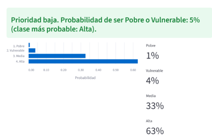

8.3 Despliegue básico

El modelo final (PPOM) se desplegó en una aplicación web con Streamlit, donde la app recibe por defecto los datos del escenario final A+B+C: quiénes viven en el hogar (bloque A), cómo es la vivienda (bloque B) y la situación de trabajo, salud y productos financieros del hogar (bloque C). Esta es la interfaz inicial, con ellos devuelve la probabilidad de que el hogar sea Pobre, Vulnerable, Media o Alta, y una prioridad de visita.

La prioridad es alta cuando P(Pobre) + P(Vulnerable) supera el umbral definido en el análisis de costos. Se debe tener en cuenta que la app no reemplaza la medición oficial de pobreza: sirve para decidir a qué hogares hacer primero una evaluación completa de ingreso cuando todavía no se conoce su ingreso.

Para garantizar la coherencia entre los datos de entrenamiento y los de uso, la app carga el mismo Pipeline guardado, que incluye la imputación, la codificación y el escalamiento aprendidos con el 80 % de entrenamiento. A ese Pipeline le entrega una fila con las mismas columnas y códigos de X_hogar. Solo se ofrecen las categorías que aparecen en el entrenamiento. Antes de predecir se valida que el hogar sea coherente (por ejemplo, que los menores y los mayores no superen el total de personas) y se avisa si algún valor está por fuera de lo observado .

La app tiene tres pestañas:

Priorizar un hogar, que como ya se mencionó usa principalmente A+B+C, pero se agregó un interruptor para usar el escenario A+B cuando no se cuenta con información de trabajo, salud y productos financieros.
Lista de visitas, que recibe un archivo con varios hogares y los ordena por prioridad.
Monitoreo, que compara los hogares nuevos con 1.000 hogares de entrenamiento mediante la prueba de Kolmogorov-Smirnov (variables numéricas) y la diferencia de proporciones (variables categóricas). El resultado se resume en un semáforo con una acción recomendada.

El monitoreo detecta cambios en los datos, pero no indica si el modelo acierta: para eso se necesitaría el ingreso real de los hogares nuevos. La app se ejecuta con python -m streamlit run app/app.py; los pasos completos están en el README del repositorio.

Figura 1. Resultado de la app para un hogar: probabilidad de cada clase y prioridad sugerida.

