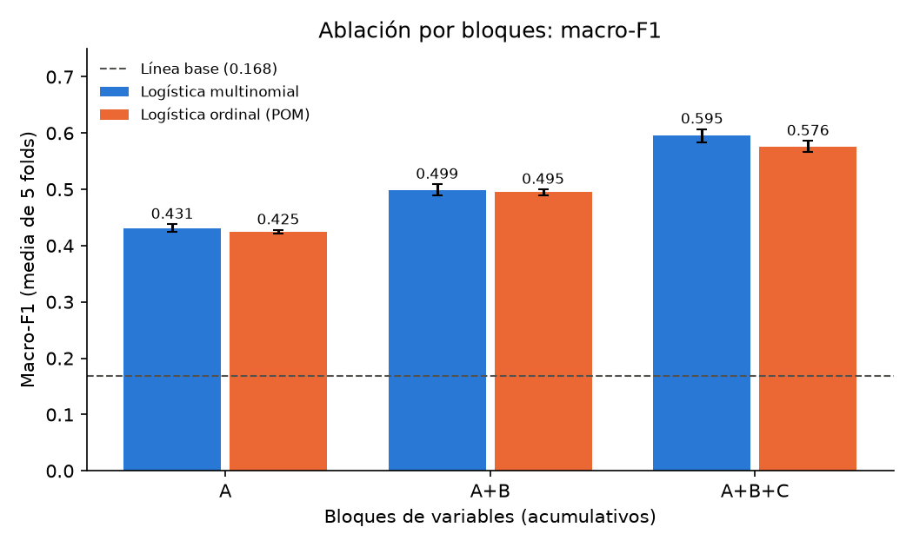
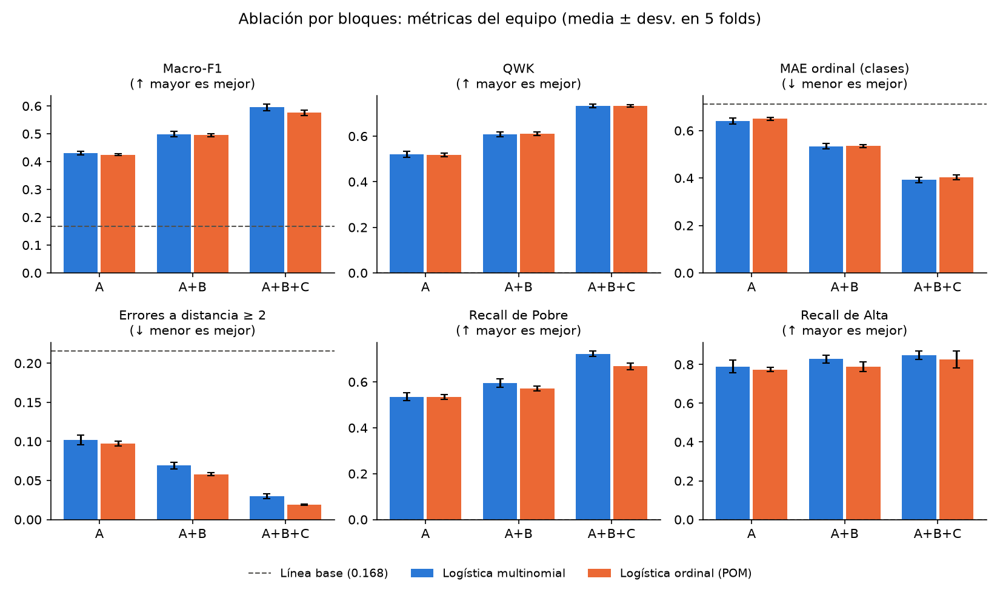
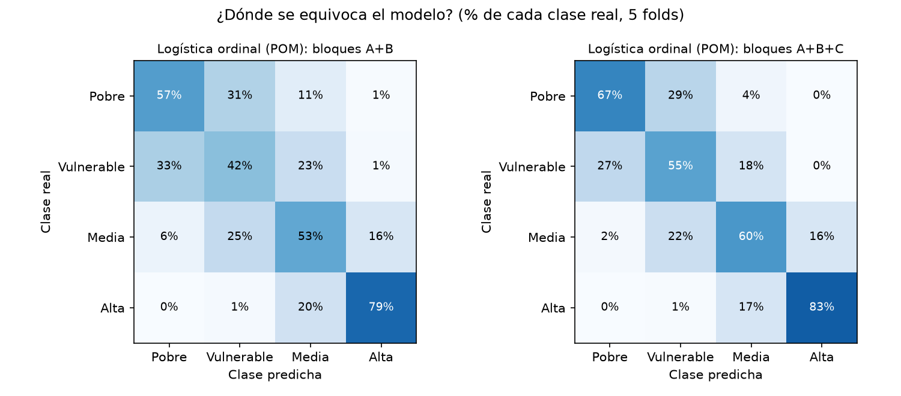
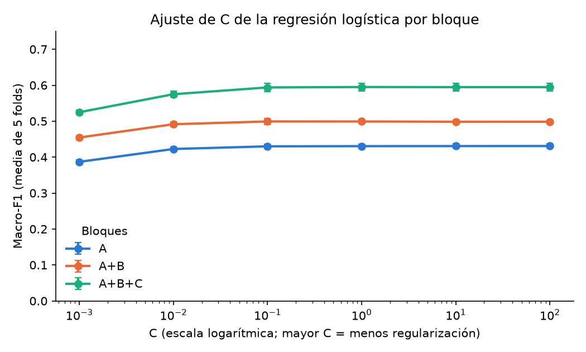

## Ablación por bloques de variables y ajuste de hiperparámetros

*Responsable: Juanita*

### Diseño

Para medir cuánto aporta cada grupo de variables, los modelos se entrenaron con tres conjuntos que los denominamos: A (demografía del hogar y del jefe), A+B (más vivienda y servicios) y A+B+C (más empleo, afiliación a salud y productos financieros), estos se compararon la regresión logística ordinal de odds proporcionales (POM), modelo principal como en el artículo, y la logística multinomial, frente a la línea base de clase mayoritaria, con los mismos folds y las seis métricas del equipo (decisión 25).

### Resultados por bloque

| Modelo | Bloques | Macro-F1 ↑ | QWK ↑ | MAE ordinal ↓ | Errores ≥ 2 ↓ | Recall Pobre ↑ | Recall Alta ↑ |
|---|---|---|---|---|---|---|---|
| Línea base | — | 0,168 ± 0,000 | 0,000 ± 0,000 | 0,712 ± 0,000 | 0,216 ± 0,000 | 0,000 ± 0,000 | 0,000 ± 0,000 |
| Logística | A | 0,431 ± 0,007 | 0,521 ± 0,014 | 0,641 ± 0,013 | 0,102 ± 0,006 | 0,535 ± 0,017 | 0,790 ± 0,034 |
| Logística | A+B | 0,499 ± 0,010 | 0,609 ± 0,011 | 0,534 ± 0,012 | 0,069 ± 0,004 | 0,595 ± 0,018 | 0,828 ± 0,021 |
| Logística | A+B+C | 0,595 ± 0,012 | 0,733 ± 0,008 | 0,392 ± 0,012 | 0,030 ± 0,003 | 0,723 ± 0,013 | 0,849 ± 0,022 |
| POM | A | 0,425 ± 0,003 | 0,518 ± 0,008 | 0,650 ± 0,007 | 0,097 ± 0,003 | 0,535 ± 0,010 | 0,774 ± 0,010 |
| POM | A+B | 0,495 ± 0,005 | 0,610 ± 0,008 | 0,535 ± 0,007 | 0,058 ± 0,002 | 0,571 ± 0,010 | 0,789 ± 0,025 |
| POM | A+B+C | 0,576 ± 0,010 | 0,733 ± 0,006 | 0,404 ± 0,010 | 0,019 ± 0,001 | 0,668 ± 0,014 | 0,826 ± 0,043 |

**Tabla 3.** Resultados de la ablación en validación cruzada (media ± desviación en 5 folds).

De acuerdo a la gráfica podemos decir que los dos modelos superan ampliamente la línea base (macro-F1 = 0,168) y cada bloque mejora al anterior, además con el POM, el macro-F1 pasa de 0,425 (A) a 0,495 (A+B) y a 0,576 (A+B+C); con la logística, de 0,431 a 0,499 y a 0,595, entonces se concluye que cada mejora es al menos seis veces mayor que la desviación entre folds (≤ 0,012), por lo que no se explica por la partición. El bloque C es el que más aporta, pero sus variables (cotizar a pensión, régimen subsidiado, productos financieros) son proxies cercanos al ingreso; por eso proponemos reportar A+B como el modelo comparable con el artículo y A+B+C como techo de desempeño, es decir, el máximo desempeño que puede llegar a tener el modelo si se tienen en cuenta todas las variables.

### POM frente a logística

En esta gráfica podemos evidenciar que se comparan los dos modelos en todas las métricas, por lo tanto se dice que ambos rinden de forma parecida (QWK ≈ 0,73 en A+B+C), pero el POM comete menos errores graves en todos los bloques: en A+B+C, el 1,9 % de los hogares queda a dos o más clases de la real, frente al 3,0 % de la logística. Esto es coherente con que el POM incorpora el orden de las clases. La logística, en cambio, detecta más hogares pobres (recall 0,72 frente a 0,67), esto es un hallazgo relevante que cabe resaltar porque se puede usar para una implementación en el área social.

### Dónde se equivoca el modelo

Aquí vemos que se evidencia cómo el POM determina a qué clase se asigna cada clase real, entonces los errores ocurren casi siempre entre clases vecinas: prácticamente ningún hogar pobre se clasifica como de clase alta. Al agregar el bloque C mejora sobre todo la detección de las clases bajas (Pobre pasa de 57 % a 67 % y Vulnerable de 42 % a 55 %), cabe resaltar que Vulnerable es la clase más difícil, porque se confunde hacia ambos lados.

### Ajuste de hiperparámetros

El parámetro C de la logística se ajustó por bloque con una grilla logarítmica (0,001 a 100), con `GridSearchCV` sobre el mismo `Pipeline` y los mismos folds, en la Tabla 4 muestra el C elegido y la Figura 4, el macro-F1 para cada valor probado. El POM se mantuvo sin regularizar, como en el artículo (decisión 34).

| Bloques | Mejor C | Macro-F1 |
|---|---|---|
| A | 100 | 0,431 ± 0,006 |
| A+B | 0,1 | 0,499 ± 0,009 |
| A+B+C | 1 | 0,595 ± 0,011 |

**Tabla 4.** Mejor C de la regresión logística por bloque (`reports/tables/mejores_C.csv`).

En conclusión, de acuerdo a la gráfica nos dice que desde C = 0,1 el macro-F1 se estabiliza en los tres bloques y las diferencias quedan por debajo de la desviación entre folds; con C ≤ 0,01 el modelo subajusta. El mejor C de A queda en el borde de la grilla, pero la curva es plana, así que ampliarla no cambia el resultado. El orden entre bloques no cambia con C, de modo que la conclusión de la ablación no depende del ajuste, es decir que para todos los valores de C probados, el orden entre bloques se mantiene entonces la ablación no depende del hiperparámetro que se elija.